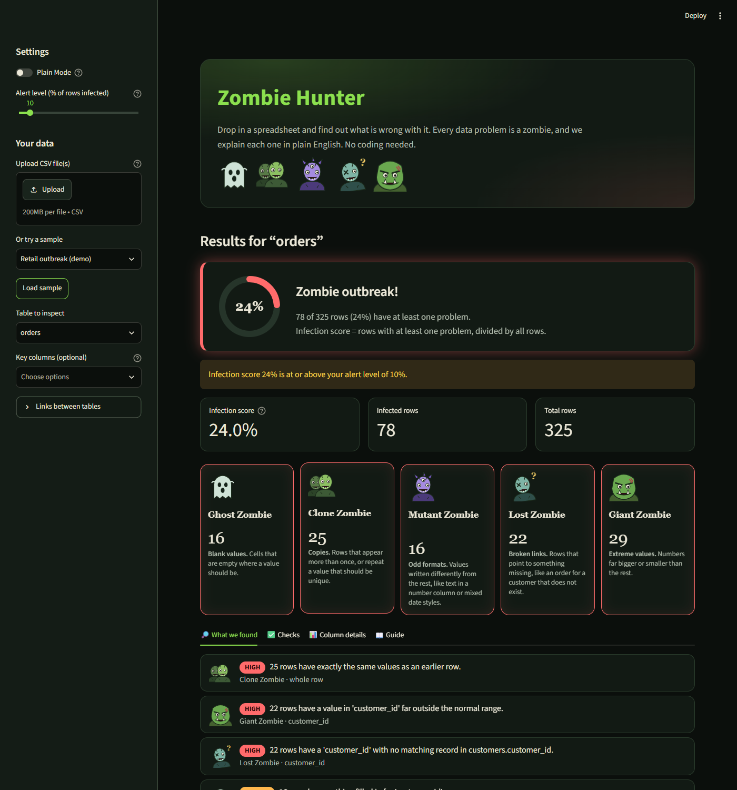

# DE Bro Code: Zombie Edition

A data engineer's AI teammate for Kiroween 2026 (Skeleton Crew). One shared core, two apps:

- **Zombie Hunter**: profile CSVs, find data "zombies", generate and run checks.
- **SQL Autopsy**: explain, lint and trace lineage for SQL, and generate ETL docs.

Status: all planned features are built (see `TODO.md`). Live links come after deployment.

## Run

```
pip install -r requirements.txt
streamlit run apps/zombie_hunter/app.py
streamlit run apps/sql_autopsy/app.py
pytest -q
```

## Zombie Hunter



- **Alert:** a full-screen alert appears above your alert level (default 10%). Try the *Retail outbreak (demo)* sample.
- **Plain Mode:** turns off the theme, pictures and alert, and shows the same findings as tables.
- **Reduced motion:** users who prefer reduced motion get no animation and no overlay, only a banner.

## SQL Autopsy

- **Paste or upload SQL:** `.sql` files with many statements and stored procedures (SQL Server, PostgreSQL, Snowflake, BigQuery and more). You get a file summary, a statement picker, and a list of steps that were not analysed (IF, DECLARE, ...).
- **Per statement:** plain-English steps, possible problems with how to fix them, and where every column comes from.
- **Your tables (optional):** upload CSVs or use the retail sample. SQL Autopsy then finds tables and columns that do not exist (with "Did you mean ...?"), columns that are in more than one table, and joins that multiply rows. **Try it on your tables** previews the result.

### Security on the public app
- Only one read-only SELECT can run. Changes, file access, COPY, ATTACH, PRAGMA, SET and INSTALL are refused before anything runs.
- The DuckDB database is locked after loading: no file or URL access, settings frozen, 512 MB memory, 2 threads.
- Previews return at most 100 rows and stop after 5 seconds. Uploads: CSV up to 50 MB (10 files), `.sql` up to 1 MB.
- Files and SQL stay in your browser session. Nothing is stored or logged.

- **Download documentation:** a Markdown file with a summary, a Mermaid data-flow diagram, and every statement explained. From the command line: `py scripts/gen_docs.py path/to/file.sql --dialect mysql` (writes to `docs/generated/`).

## Security on the public apps
- Both apps lock their DuckDB database right after loading your CSVs: no file or URL access, settings frozen, 512 MB memory, 2 threads.
- Zombie Hunter stops any check or custom rule after 10 seconds. SQL Autopsy previews stop after 5 seconds and return at most 100 rows.
- Nothing you upload or paste is stored or logged.

## Kiro
- **Specs:** one per task in `.kiro/specs/`. **Steering:** `.kiro/steering/` (product, tech, structure).
- **MCP server:** `mcp_server/server.py` with tools `profile_csv` and `analyze_sql`, registered in `.kiro/settings/mcp.json`. It ships switched off (`"disabled": true`); set it to `false` to let Kiro call it. It runs locally over stdio and never executes SQL.
- **Property-based tests:** Hypothesis checks the profiler, the generated checks, custom rules and the SQL parser against plain Python.

## Later
Databricks and BigQuery connections, through the same `Connector` interface.

## License

MIT
